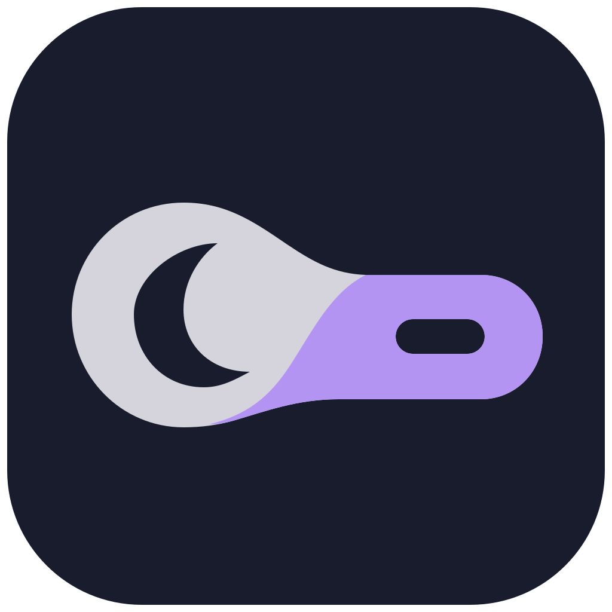

<div align="center">
  
  <h1>Lunotch</h1>
  <p><strong>Your Mac, a little more alive.</strong></p>
  <p>A small, animated notch companion for macOS, built with SwiftUI.</p>
  <p><a href="https://github.com/SemiAutomat1c/Lunotch/releases/tag/v0.1.0-preview.3"><strong>Download the macOS preview (DMG)</strong></a> · <a href="docs/LOCAL_TESTING.md">Testing guide</a> · <a href="#roadmap">Roadmap</a></p>
</div>

> **Preview / personal project.** Lunotch is an experimental derivative of [Boring Notch](https://github.com/TheBoredTeam/boring.notch), shared under **GPL-3.0**. Its music-first layout and motion direction are inspired by public demonstrations of [Alcove](https://tryalcove.com/). Lunotch has its own branding and implementation changes and is **not affiliated with or endorsed by** the Boring Notch team or Alcove.

**Version note:** **v0.1.0-preview.3** (build 3) adds the 400 × 166-point focused music panel, Screenshot Studio, Work Mode, and the latest Lunotch icon, logo, and language cleanup. This experimental Apple Silicon preview remains ad-hoc signed and unnotarized; screen-capture permission and interactive editor tests, visual layout checks, and broader compatibility testing remain open. See the [testing guide](docs/LOCAL_TESTING.md).

## What it does

Lunotch turns the top of your Mac screen into a lightweight space for music and quick interactions. This first preview focuses on how the notch opens, moves and responds.

- **Music-first expanded view:** album art, track and artist, playing indicator, elapsed and remaining times, draggable seek bar, and five configurable media actions. The default actions are Shuffle / Previous / Play-Pause / Next / Sound Output; the last action opens macOS Sound settings. Favorite and Volume remain configurable; an in-notch audio-output picker is planned.
- **Compact panel:** the focused Home music shell measures **400 × 166 points in preview.3** (58-point artwork), reduced from **450 × 180 points** in preview.2. It stays compact even if playback pauses or media goes idle; when there is no player, it can show **Nothing Playing**. Settings → Media → **Use compact music player on Home** enables or disables this behavior. The larger **640 × 190-point** layout remains for other views such as the shelf and expanded camera.
- **Screenshot Studio (experimental in preview.3):** launch native ScreenCaptureKit selection from the notch header or menu, edit an image from the clipboard or disk, or opt into previews of screenshots saved to a chosen folder. Capture shows a crosshair on the selected display and requires macOS Screen & System Audio Recording permission. The editor has crop, pen, highlight, arrows, shapes, text, opaque redaction, Undo/Redo, Fit, 50–400% zoom, copy and PNG export. Interactive capture and macOS permission behavior still need on-device testing.
- **Work Mode (experimental in preview.3):** an optional separate window, opened through the menu bar or notch context menu, offers 15/25/45/60-minute focus sessions, an approximate RAM overview, an explicitly selected browser-close action with confirmation, and a Markdown research note scratchpad. For this sandboxed app, notes append to `~/Library/Containers/dev.ryandeniega.lunotch/Data/Library/Application Support/Lunotch/ResearchNotes.md`, with clipboard URL import and source-reference copy. The timer continues while the window is hidden but resets if Lunotch quits. Browser closure is voluntary and can interrupt unsaved work; the memory display does not free or reserve RAM.
- **Responsive motion:** interruptible spring-based open/close transitions, pointer-tracking during drags, configurable hover delay, and a reduced-motion path.
- **Boring Notch features retained in source:** media controls, file shelf and AirDrop integration, calendar and reminders views, camera mirror, battery and charging indicators, and system HUDs. These inherited flows still need broader regression testing in Lunotch.
- **Lunotch identity:** the **B2 Lunar Droplet** design is applied to the Xcode app icon, native light/dark menu-bar template symbol, in-app logos and wordmarks in preview.3. See the [brand guide](docs/BRAND_IDENTITY.md) for sources and regeneration instructions.

The focused player is inspired by Alcove's layout; it is **not** a pixel-perfect replica. Screenshots and live animations will be added after visual QA.

## Install

**Download:** [Lunotch v0.1.0-preview.3 — GitHub Release](https://github.com/SemiAutomat1c/Lunotch/releases/tag/v0.1.0-preview.3). Choose `Lunotch-v0.1.0-preview.3-arm64.dmg` under **Assets**.

1. Open the DMG and drag **Lunotch.app** to **Applications**.
2. Quit any already-running copy of Lunotch or Boring Notch to avoid overlapping notch overlays.
3. Open Lunotch from Applications. It works primarily from the notch/menu bar, so it may not appear in the Dock.
4. Because this preview is **ad-hoc signed and not Apple notarized**, macOS may block the first launch. Try opening the app once, then use **System Settings → Privacy & Security → Open Anyway** if offered. Only override this warning if you trust the download and have checked its release details. You can also build directly from source.
5. Grant only the macOS permissions you need for optional features, such as camera, calendar/reminders, or media control. **Screenshot Studio’s Capture Selection** requires **Screen & System Audio Recording** permission under System Settings → Privacy & Security; restart Lunotch after granting access if macOS requests it.

**Compatibility:** This DMG is built for **Apple Silicon (arm64)**. It was compiled on macOS 26 with Xcode 26. The Xcode project currently targets macOS 14, but a bundled media adapter targets macOS 15; macOS 15 or newer is the practical starting point. Compatibility across macOS versions, external monitors, and Intel Macs has **not** been verified. No auto-updater is included.

A SHA-256 checksum is provided in the [release notes](https://github.com/SemiAutomat1c/Lunotch/releases/tag/v0.1.0-preview.3) for checking downloaded DMGs.

## Build from source

Requires macOS, Xcode, and Swift Package Manager dependency access.

```bash
git clone https://github.com/SemiAutomat1c/Lunotch.git
cd Lunotch
open boringNotch.xcodeproj
```

Choose scheme **boringNotch** and build in Xcode. The project and several internal source names still reflect its Boring Notch origins. To build from Terminal without an Apple Developer certificate:

```bash
xcodebuild -project boringNotch.xcodeproj \
  -scheme boringNotch -configuration Debug \
  -destination 'platform=macOS,arch=arm64' \
  CODE_SIGNING_ALLOWED=NO build
```

For a local Release build, Xcode can ad-hoc sign with `CODE_SIGN_IDENTITY=-`. The [DMG packaging script](scripts/package-dmg.sh) packages an already-built `Lunotch.app` into a drag-to-Applications installer; [release instructions](docs/RELEASING.md) describe the process. Packaging does **not** notarize the app.

## Current status and known limits

This is a **preview**, not a stable or audited release. Compilation and signing verification have passed on the development machine. The app has launched with its embedded helper, but the new layout's physical dimensions, animations, shelf, media actions, camera, external monitors, permissions, macOS compatibility and accessibility behavior have **not** all been verified through hands-on testing. See the [local QA checklist](docs/LOCAL_TESTING.md) and [development log](docs/GOAL.md). Upstream Swift concurrency warnings and a macOS minimum-version mismatch in the bundled media adapter also remain.

**Earlier preview.2 changes:** The idle-state switch back to the older, wider Home player was traced to playback-state conditions; compact Home now remains selected through idle with a no-media placeholder. The focused album art is explicitly clipped to 68 × 68 points, the 100% battery label is kept on one line, and notch/view changes have explicit native animations. The project also uses B2 identity assets in the app icon, menu bar and in-app surfaces. **These changes were build-verified, but screen captures and human interaction QA were unavailable in this session.** A restart helper can also choose an older installed copy when multiple builds share a bundle ID; if a legacy layout reappears, quit all copies and launch the intended app explicitly.

**Preview.3 changes (November 9):** The focused Home player now uses a **400 × 166-point** panel and **58 × 58-point** album art, with five transport controls and tighter battery/header spacing. Screenshot Studio adds user-triggered ScreenCaptureKit selection capture, clipboard/file import, an annotation editor, and optional screenshot-folder previews. Work Mode adds a timer, memory summary, user-confirmed browser close, and a Markdown research scratchpad; live QA previously confirmed timer Start/Pause/Reset, memory display, browser-close **Cancel**, and note Save/Append. The B2 Lunar Droplet icon and native menu mark are retained, with unused upstream icons removed and visible legacy About/Appearance/onboarding text replaced. The latest signed Debug build and static checks passed, but **actual screen-recording permission and selection/editor UI, display-level layout, multiwindow behavior, and broader macOS compatibility are still unverified**. The downloadable Release DMG uses ad-hoc signing; macOS privacy permission may need to be granted again after changing between signed builds.

## Roadmap

- [x] Lunotch naming, initial identity, and About attribution
- [x] B2 Lunar Droplet icon, menu-bar symbol and in-app identity included in preview.3
- [x] Compact music-first view with configurable controls
- [x] Keep compact Home mode selected through playback idle state (manual QA pending)
- [x] Hover/drag motion refinements and reduced-motion code path
- [x] First Apple Silicon DMG preview
- [x] Implement Screenshot Studio (included in preview.3; interactive QA pending)
- [x] Implement separate-window Work Mode with focus, memory, browser break and research notes (included in preview.3; further QA pending)
- [ ] Test Screenshot Studio screenshot permissions, markup, Undo/Redo, zoom and clipboard/PNG results on-device
- [x] Test Work Mode 15-minute timer start/pause/reset, memory display, Markdown save/append and browser confirmation Cancel on-device
- [ ] Complete Work Mode QA for other timer presets, completion beep, clipboard links and multiwindow lifecycle
- [ ] Manual QA on hover, scrubbing, music/HUD, shelf, camera and calendar
- [ ] Finish focused-player typography and responsive sizing against real display captures
- [ ] Visually check B2 Finder icon, menu-bar symbol and in-app marks on-device (integrated in source)
- [ ] Test compact Home through pause and media idle, including the Nothing Playing placeholder
- [ ] Add an in-notch output-device/AirPlay picker instead of opening macOS Sound settings
- [ ] Test notchless Macs, external displays, sleep/wake and multiple macOS versions
- [ ] Accessibility and performance profiling of animations
- [ ] Resolve Swift concurrency and deployment-target warnings
- [ ] Developer ID signing, notarization, and safer automatic distribution
- [ ] Automated build checks and polished release screenshots

Feature suggestions and bug reports can go in [Issues](https://github.com/SemiAutomat1c/Lunotch/issues); work is maintained on a best-effort basis.

## Credits and license

**Lunotch is based on [TheBoredTeam/boring.notch](https://github.com/TheBoredTeam/boring.notch).** Thank you to its authors, contributors and maintainers for the core notch, media, shelf, HUD, calendar and settings work. This repository retains the original upstream source history and copyright notices. Original Boring Notch sources and Lunotch modifications are distributed under the [GNU General Public License v3.0](LICENSE). You may inspect, modify and redistribute the source under that license's terms; downstream distributions must comply with GPL-3.0 obligations.

See [THIRD_PARTY_LICENSES](THIRD_PARTY_LICENSES) for upstream third-party notices. Notable upstream dependencies and ideas include [MediaRemoteAdapter](https://github.com/ungive/mediaremote-adapter), [NotchDrop](https://github.com/Lakr233/NotchDrop), and [DynamicNotchKit](https://github.com/MrKai77/DynamicNotchKit). [Alcove](https://tryalcove.com/) is an independent commercial app used as a design reference; no affiliation or endorsement is implied.

Lunotch is offered **as-is**, with no warranty. If you use the original Boring Notch app, download it from [its own releases](https://github.com/TheBoredTeam/boring.notch/releases), not from this repository.
