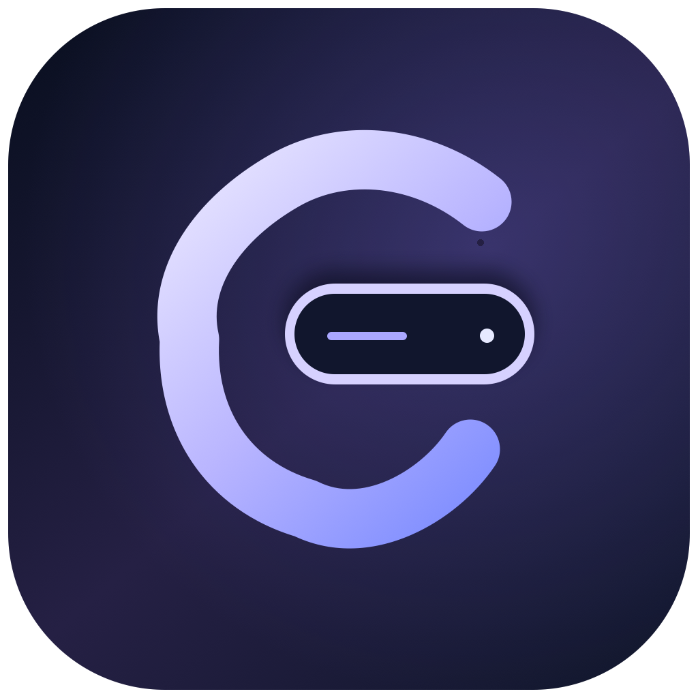

<div align="center">
  
  <h1>Lunotch</h1>
  <p><strong>Your Mac, a little more alive.</strong></p>
  <p>A small, animated notch companion for macOS, built with SwiftUI.</p>
  <p><a href="https://github.com/SemiAutomat1c/Lunotch/releases/tag/v0.1.0-preview.1"><strong>Download the macOS preview (DMG)</strong></a> · <a href="docs/LOCAL_TESTING.md">Testing guide</a> · <a href="#roadmap">Roadmap</a></p>
</div>

> **Preview / personal project.** Lunotch is an experimental derivative of [Boring Notch](https://github.com/TheBoredTeam/boring.notch), shared under **GPL-3.0**. Its music-first layout and motion direction are inspired by public demonstrations of [Alcove](https://tryalcove.com/). Lunotch has its own branding and implementation changes and is **not affiliated with or endorsed by** the Boring Notch team or Alcove.

## What it does

Lunotch turns the top of your Mac screen into a lightweight space for music and quick interactions. This first preview focuses on how the notch opens, moves and responds.

- **Music-first expanded view:** album art, track and artist, playing indicator, elapsed and remaining times, draggable seek bar, and five configurable media actions. The current default last action controls volume; audio-output selection is planned.
- **Compact panel:** a focused music shell set to **450 × 180 points**, with a larger layout available for other content.
- **Responsive motion:** interruptible spring-based open/close transitions, pointer-tracking during drags, configurable hover delay, and a reduced-motion path.
- **Boring Notch features retained in source:** media controls, file shelf and AirDrop integration, calendar and reminders views, camera mirror, battery and charging indicators, and system HUDs. These inherited flows still need broader regression testing in Lunotch.
- **Original identity:** Lunotch app icon, wordmarks, accent colors and About information.

The focused player is inspired by Alcove's layout; it is **not** a pixel-perfect replica. Screenshots and live animations will be added after visual QA.

## Install

**Download:** [Lunotch v0.1.0-preview.1 — GitHub Release](https://github.com/SemiAutomat1c/Lunotch/releases/tag/v0.1.0-preview.1). Choose `Lunotch-v0.1.0-preview.1-arm64.dmg` under **Assets**.

1. Open the DMG and drag **Lunotch.app** to **Applications**.
2. Quit any already-running copy of Lunotch or Boring Notch to avoid overlapping notch overlays.
3. Open Lunotch from Applications. It works primarily from the notch/menu bar, so it may not appear in the Dock.
4. Because this preview is **ad-hoc signed and not Apple notarized**, macOS may block the first launch. Try opening the app once, then use **System Settings → Privacy & Security → Open Anyway** if offered. Only override this warning if you trust the download and have checked its release details. You can also build directly from source.
5. Grant only the macOS permissions you need for optional features, such as camera, calendar/reminders, or media control.

**Compatibility:** This DMG is built for **Apple Silicon (arm64)**. It was compiled on macOS 26 with Xcode 26. The Xcode project currently targets macOS 14, but a bundled media adapter targets macOS 15; macOS 15 or newer is the practical starting point. Compatibility across macOS versions, external monitors, and Intel Macs has **not** been verified. No auto-updater is included.

A SHA-256 checksum is provided in the [release notes](https://github.com/SemiAutomat1c/Lunotch/releases/tag/v0.1.0-preview.1) for checking downloaded DMGs.

## Build from source

Requires macOS, Xcode, and Swift Package Manager dependency access.

```bash
git clone https://github.com/SemiAutomat1c/Lunotch.git
cd Lunotch
open boringNotch.xcodeproj
```

Choose scheme **boringNotch** and build in Xcode. The project and several internal source names still reflect its Boring Notch origins. To build from Terminal without an Apple Developer certificate:

```bash
xcodebuild -project boringNotch.xcodeproj \
  -scheme boringNotch -configuration Debug \
  -destination 'platform=macOS,arch=arm64' \
  CODE_SIGNING_ALLOWED=NO build
```

For a local Release build, Xcode can ad-hoc sign with `CODE_SIGN_IDENTITY=-`. The [DMG packaging script](scripts/package-dmg.sh) packages an already-built `Lunotch.app` into a drag-to-Applications installer; [release instructions](docs/RELEASING.md) describe the process. Packaging does **not** notarize the app.

## Current status and known limits

This is a **preview**, not a stable or audited release. Compilation and signing verification have passed on the development machine. The app has launched with its embedded helper, but the new layout's physical dimensions, animations, shelf, media actions, camera, external monitors, permissions, macOS compatibility and accessibility behavior have **not** all been verified through hands-on testing. See the [local QA checklist](docs/LOCAL_TESTING.md) and [development log](docs/GOAL.md). Upstream Swift concurrency warnings and a macOS minimum-version mismatch in the bundled media adapter also remain.

## Roadmap

- [x] Lunotch naming, logo, app icon, and About attribution
- [x] Compact music-first view with configurable controls
- [x] Hover/drag motion refinements and reduced-motion code path
- [x] First Apple Silicon DMG preview
- [ ] Manual QA on hover, scrubbing, music/HUD, shelf, camera and calendar
- [ ] Finish focused-player typography and responsive sizing against real display captures
- [ ] Add an actual output-device/AirPlay picker instead of the volume shortcut
- [ ] Test notchless Macs, external displays, sleep/wake and multiple macOS versions
- [ ] Accessibility and performance profiling of animations
- [ ] Resolve Swift concurrency and deployment-target warnings
- [ ] Developer ID signing, notarization, and safer automatic distribution
- [ ] Automated build checks and polished release screenshots

Feature suggestions and bug reports can go in [Issues](https://github.com/SemiAutomat1c/Lunotch/issues); work is maintained on a best-effort basis.

## Credits and license

**Lunotch is based on [TheBoredTeam/boring.notch](https://github.com/TheBoredTeam/boring.notch).** Thank you to its authors, contributors and maintainers for the core notch, media, shelf, HUD, calendar and settings work. This repository retains the original upstream source history and copyright notices. Original Boring Notch sources and Lunotch modifications are distributed under the [GNU General Public License v3.0](LICENSE). You may inspect, modify and redistribute the source under that license's terms; downstream distributions must comply with GPL-3.0 obligations.

See [THIRD_PARTY_LICENSES](THIRD_PARTY_LICENSES) for upstream third-party notices. Notable upstream dependencies and ideas include [MediaRemoteAdapter](https://github.com/ungive/mediaremote-adapter), [NotchDrop](https://github.com/Lakr233/NotchDrop), and [DynamicNotchKit](https://github.com/MrKai77/DynamicNotchKit). [Alcove](https://tryalcove.com/) is an independent commercial app used as a design reference; no affiliation or endorsement is implied.

Lunotch is offered **as-is**, with no warranty. If you use the original Boring Notch app, download it from [its own releases](https://github.com/TheBoredTeam/boring.notch/releases), not from this repository.
